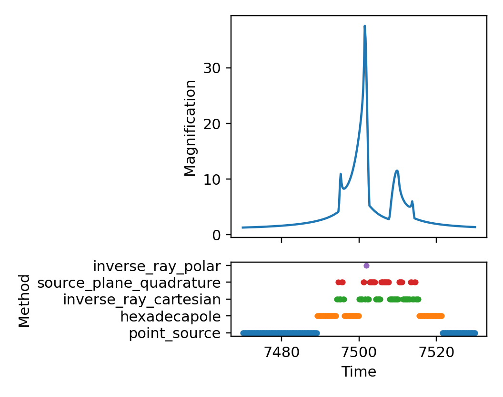
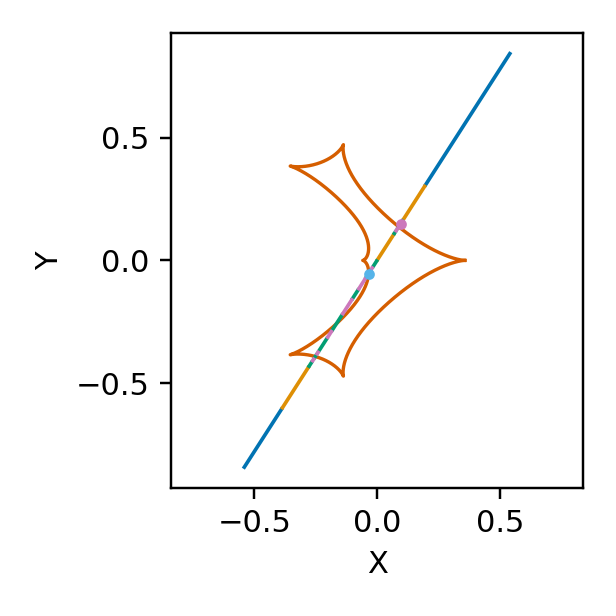

[Previous: Limb darkening](LimbDarkening.md) · [Documentation home](readme.md) · [Next: Coordinates and conventions](Coordinates.md)

# Accuracy control

> VBMicrolensing correspondence: [AccuracyControl.md](https://github.com/valboz/VBMicrolensing/blob/main/docs/python/AccuracyControl.md). The `s=0.8`, `q=0.1`, source-position, source-radius, and tolerance examples are retained.

A single-source binary `LightCurve` defaults to the
algebraic-boundary backend. The standard router examples below set
`finite_source_backend="default"` explicitly; this is required when testing
its point-source, hexadecapole, Cartesian, or polar choices. Low-level
`binary_ray_shooting()` calls keep their own route selection.

Use the same lens and source values while changing only the requested absolute
accuracy:

```python
import lcbinint

s, q, y1, y2, rho = 0.8, 0.1, 0.01, 0.01, 0.01

mag_1e3 = lcbinint.binary_ray_shooting(
    y1, y2, s=s, q=q, rho=rho,
    options=lcbinint.Options(tol=1e-3),
)
print("Magnification (accuracy at 1.e-3) =", mag_1e3)

mag_1e4 = lcbinint.binary_ray_shooting(
    y1, y2, s=s, q=q, rho=rho,
    options=lcbinint.Options(tol=1e-4),
)
print("Magnification (accuracy at 1.e-4) =", mag_1e4)
```

## Precision control

```python
mag_rel_1e1 = lcbinint.binary_ray_shooting(
    y1, y2, s=s, q=q, rho=rho,
    options=lcbinint.Options(reltol=1e-1),
)
print("Magnification (relative precision at 1.e-1) =", mag_rel_1e1)
```

## How the tolerance is applied

`lcbinint` uses one budget at each epoch:

```text
tol + reltol * max(abs(magnification), 1)
```

`tol` is the absolute term and `reltol` is the relative term. If either term is
set explicitly, the other term is zero unless it is also supplied. If both are
left at zero, the calibrated default is equivalent to `1e-4 + 1e-3 *
max(abs(magnification), 1)`.

The returned value is not made accurate merely by requesting a tolerance.
Inspect `finite_source_converged` and `finite_source_error_estimates` when the
result matters scientifically.

## Value convergence and image coverage

For the default algebraic-boundary CPU path, inspect these independent fields
on the returned `LightCurveInfo`, including when diagnostics are disabled:

- `value_converged`: the value met the integration error budget.
- `support_required`: this epoch used the finite-source integral.
- `seed_support_proven`: the component-seeding check passed.
- `frontier_discovery_completed`: local radial exploration finished; false is
  also expected when a smooth source-disk chart was used instead.
- `support_certified`: global coverage was certified. The current integral
  does not produce this certificate, even when seeding and integration pass.

`status_names` distinguishes `unconverged` (value budget not met),
`support_unproven` (seeding remains unresolved), and `coverage_uncertified`
(value converged and seeding passed, but global coverage remains uncertified).
Value failure takes priority; inspect diagnostics for the integration stop.
`coverage_uncertified` has numeric code 3; existing codes 0, 1, and 2 retain
their values. `all_values_converged` checks value convergence alone, whereas
`all_converged` remains false for every uncertified epoch. Neither finite
values nor seeding success certify numerical accuracy or global coverage.

The JAX FFI currently exports only value convergence and aggregate support
flags. Its unresolved support remains `support_unproven`; the finer seeding
and discovery fields are `None` when unavailable. Other backends retain
their existing support contracts. Do not interpret a false seed/discovery
flag at an epoch with `support_required=False` as a failed integral.

Value-only calls use the native path without building optional diagnostic
arrays, strings, or per-epoch timings. Request `with_diagnostics=True` to
include those details. Both modes apply the same numerical settings and retain
the convergence and support fields above. No JAX setting or warmup is needed
for this default path.

## Lens orbital motion

The default single-source binary route accepts `orbital_motion="circular"`
or `"kepler"`, with `t_ref` set on `LightCurve`. Pass `g1`, `g2`, `g3` and,
for Kepler orbits, `lom_szs` and `lom_ar` in the parameter mapping.
`t_ref=0` follows `t0`, matching the existing native reference-time convention. Annual,
terrestrial and satellite parallax use the existing trajectory implementation.
Xallarap and binary sources retain the standard router.

The ordinary native call evaluates the orbit and lens-frame source at each
input time within one C++ call. It retains the point/hex/integral selector,
validated root continuation, analytic caustic strip, and continuous caustic
cover. An analytic radial caustic bound can certify distant sources. A parameter-interval
Rouché bound can reuse the continuous cover over a proved range of separations;
failure retains the exact-separation fallback. Unsorted dynamic input is
processed in an order that reuses geometry, then restored to input order. Nearby
sources retain the existing geometry checks and topology guards.

For varying separation, a hierarchy of continuous critical-phase enclosures
can certify that the source disk is separated from every caustic. Each enclosure
also covers a small interval of separations. Its polynomial reconstruction
error allows root centres from the previous separation to be reused; roots are
recomputed when those centres make the enclosure too loose. A failed proof
uses the boundary integral, with the full caustic geometry retained for seed
completion when a source disk can intersect a caustic. Constant separation and
already available exact geometry retain the cached-geometry selector.

The algebraic route's `caustic_distance` diagnostic may be a conservative lower
bound. Zero means no positive clearance was established by the shortcut; it
does not locate the source centre on a caustic. Magnification tolerances and
the point/hex error checks still apply independently of this topology test.

With `with_gradient=True`, the fused native pass computes the five local
lens derivatives once. A cached JAX trajectory Jacobian maps them to model
parameters without repeating lens integration. Static curves keep their fixed
seven columns. Dynamic curves return those seven columns followed by additional
supplied parameters; read `gradient_parameters` for their names. This mapping
requires JAX with float64 enabled. Limb-darkening derivatives remain uncertified.

For HMC, `jax.jit(jax.value_and_grad(loss))` can compose the same public call
with the likelihood. The FFI accepts scalar separation or a vector matching
the source epochs; its custom JVP propagates each epoch's separation tangent,
and reverse mode accumulates the model-parameter gradient. Compilation is a
one-time cost per shape. The native `with_gradient` call returns a full
per-epoch Jacobian, whereas a scalar likelihood can use reverse mode directly.

## Evaluation modes

A finite-source light curve can move between several methods from epoch to
epoch:

| Reported method | Meaning |
| --- | --- |
| `algebraic_boundary` | Integrates the supported binary finite-source curve over the image boundary. |
| `point_source` | Source size is safely negligible at this position. |
| `hexadecapole` | A fourth-order finite-source expansion is locally safe. |
| `source_plane_quadrature` | The source disk is integrated in the source plane. |
| `inverse_ray_cartesian` | A Cartesian inverse-ray grid resolves the finite images. |
| `inverse_ray_polar` | A polar inverse-ray grid is selected for suitable high-magnification geometry. |

`inverse_ray_grid` controls the standard router's inverse-ray method; it does
not disable that router's safe point-source or hexadecapole fast paths.

```python
automatic = lcbinint.Options(
    nbin="auto",
    inverse_ray_grid="auto",
    tol=1e-4,
    reltol=1e-3,
    finite_source_backend="default",
)

fixed_cartesian = lcbinint.Options(
    nbin=800,
    inverse_ray_grid="cartesian",
    tol=1e-4,
    reltol=1e-3,
    finite_source_backend="default",
)

fixed_polar = lcbinint.Options(
    nbin=800,
    polar_nbin=800,
    inverse_ray_grid="polar",
    tol=1e-4,
    reltol=1e-3,
    finite_source_backend="default",
)
```

`nbin="auto"` predicts one resolution for each binary-lens epoch from the
calibrated law, rounds upward, and evaluates it once. Its embedded error
indicator is diagnostic and does not trigger a larger grid. A fixed integer is
useful for reproducibility experiments and is also one-shot.

## Option summary

| Option | Purpose | Normal choice |
| --- | --- | --- |
| `tol`, `reltol` | Absolute and relative finite-source error budget. | Set both for a scientific accuracy target. |
| `nbin` | Automatic or fixed source-grid resolution. | `"auto"` |
| `max_source_bins` | Ceiling applied to the automatic resolution prediction. | Leave at the calibrated default unless diagnostics require more. |
| `inverse_ray_grid` | `"auto"`, `"cartesian"`, or `"polar"`. | `"auto"` |
| `polar_nbin` | Optional independent polar resolution. | `None` |
| `caustic_bins` | Sampling for detailed caustic fallback geometry and visualization. | Leave at the default for calculations. |
| `hex_tol` | Fourth-order self-consistency threshold. | Leave at the default unless validating method selection. |
| `point_source_threshold` | Geometric point-source safety margin. | Advanced validation only. |
| `finite_source_backend` | Select the model-appropriate default or explicitly request the standard router (`"default"`). | Algebraic boundary for supported binary curves. |

## Inspect the selected method

```python
import numpy as np
import matplotlib.pyplot as plt

params = {
    "s": 0.9, "q": 0.1, "u0": 0.0, "alpha": 1.0,
    "rho": 0.01, "tE": 30.0, "t0": 7500,
}
t = np.linspace(7470, 7530, 300)
curve = lcbinint.LightCurve(options=automatic)
result = curve(t, params)

method_names = list(dict.fromkeys(result.finite_source_method_names))
method_index = {name: index for index, name in enumerate(method_names, start=1)}
selected = [method_index[name] for name in result.finite_source_method_names]
# Fixed, colorblind-friendly palette; reserve vermilion for caustics below.
method_colors = ["#0173B2", "#DE8F05", "#029E73", "#CC78BC", "#56B4E9"]

fig, (mag_ax, method_ax) = plt.subplots(2, 1, sharex=True, figsize=(4.8, 3.8))
mag_ax.plot(t, result.magnifications)
mag_ax.set_ylabel("Magnification")
for color_index, name in enumerate(method_names):
    mask = np.asarray(result.finite_source_method_names) == name
    method_ax.scatter(
        t[mask], np.asarray(selected)[mask], s=10,
        color=method_colors[color_index],
    )
method_ax.set_yticks(range(1, len(method_names) + 1))
method_ax.set(xlabel="Time", ylabel="Method")
fig.tight_layout()
plt.show()
```



Use the same colors to show where each method is selected along the source
trajectory. Each uninterrupted run is drawn as one line segment; caustics are
red.

```python
methods = np.asarray(info.finite_source_method_names)
trajectory = curve.source_trajectory(t, params)
caustics = curve.caustics(params)

plt.figure(figsize=(2.8, 2.8))
for x, y in zip(caustics.x, caustics.y):
    plt.plot(x, y, color="#6C6C6C", lw=1.1)

display_x = np.asarray(trajectory.x)
display_y = np.asarray(trajectory.y)
for color_index, name in enumerate(method_names):
    indices = np.flatnonzero(methods == name)
    breaks = np.where(np.diff(indices) != 1)[0] + 1
    for run in np.split(indices, breaks):
        if len(run) > 1:
            plt.plot(
                display_x[run], display_y[run],
                color=method_colors[color_index], lw=1.2,
            )
        elif len(run) == 1:
            plt.plot(
                display_x[run], display_y[run], color=method_colors[color_index],
                marker="o", markersize=2.5,
            )
plt.xlabel("X")
plt.ylabel("Y")
plt.axis("equal")
plt.show()
```



The method numbers in the lower panel are:

1. `point_source` — point-source approximation.
2. `hexadecapole` — fourth-order finite-source approximation.
3. `inverse_ray_cartesian` — Cartesian inverse ray shooting.
4. `source_plane_quadrature` — direct source-plane integration.
5. `inverse_ray_polar` — polar inverse ray shooting.

For the calibration evidence and the exact retry rules, continue to
[Numerical methods](../numerical-methods.md).

[Previous: Limb darkening](LimbDarkening.md) · [Documentation home](readme.md) · [Next: Coordinates and conventions](Coordinates.md)

Critical-curve root prediction also permits nearby mass ratios on the same
lens-frame branch. The implicit derivative in the secondary mass fraction
provides an initial guess alongside the separation predictor. Every accepted
update still passes the polynomial residual and complete coefficient
reconstruction checks; an unsuccessful update uses the full root solver.
Caustic interval enclosures likewise try two Newton updates of cached centers
before a full solve, and retain the complete Rouché enclosure check.

Point-image prediction also includes the explicit changes of lens position and
mass in the real inverse lens Jacobian. It applies to physical images on the
same lens-frame branch; rejected polynomial roots retain their ordinary
continuation seeds. Geometry jumps, singular Jacobians and large predicted
steps skip the predictor. The polynomial/Vieta, physical-root selection and
lens-residual checks, including cold fallback, remain unchanged.
