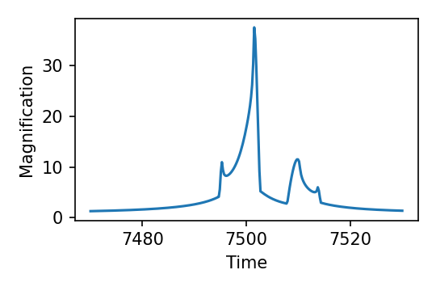
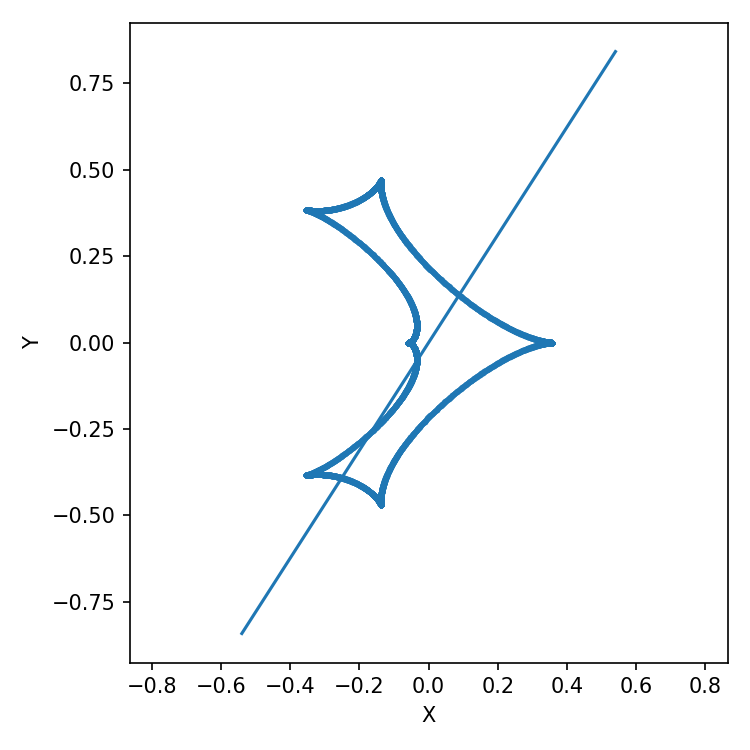
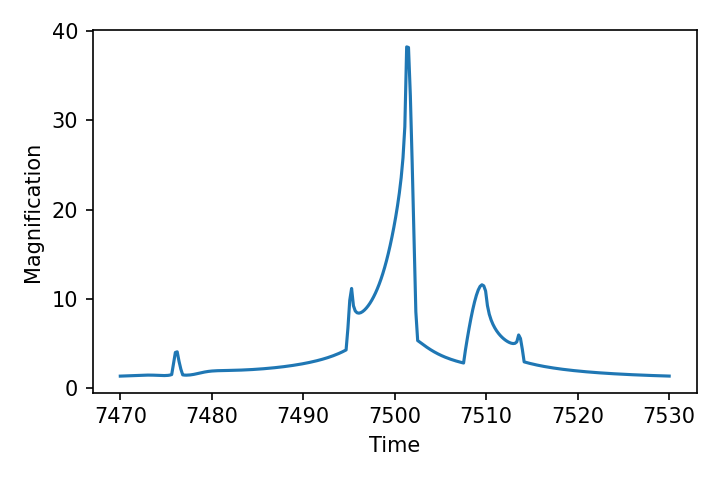
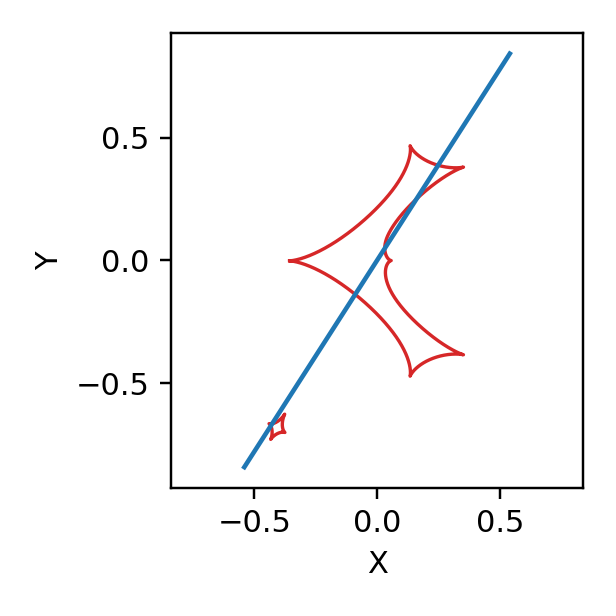

[Previous: Binary lenses](BinaryLenses.md) · [Documentation home](readme.md) · [Next: Critical curves and caustics](CriticalCurvesAndCaustics.md)

# Light Curve Functions

> VBMicrolensing correspondence: [LightCurves.md](https://github.com/valboz/VBMicrolensing/blob/main/docs/python/LightCurves.md). The binary- and triple-lens values and example order are preserved.

## Binary Lens light curve

The values below are used unchanged throughout the calculation.

```python
import numpy as np
import matplotlib.pyplot as plt
import lcbinint

s = 0.9
q = 0.1
u0 = 0.0
alpha = 1.0
rho = 0.01
tE = 30.0
t0 = 7500

params = {
    "s": s, "q": q, "u0": u0, "alpha": alpha,
    "rho": rho, "tE": tE, "t0": t0,
}
t = np.linspace(t0 - tE, t0 + tE, 300)

curve = lcbinint.LightCurve(options=lcbinint.Options(tol=1e-3, reltol=1e-3))
result = curve(t, params)
magnifications = result.magnifications
status = result.status_names
trajectory = curve.source_trajectory(t, params)
```

In this branch, a static single-source binary `LightCurve` selects the
algebraic-boundary backend by default, including when `Options()` is supplied.
To compare against the standard router explicitly, pass
`Options(finite_source_backend="default")`. Models outside the algebraic
boundary backend's supported static-binary scope continue to use the standard
router.

The call returns the magnifications and a per-epoch status together. Request
parameter gradients through the same call with `with_gradient=True`:

```python
result_with_gradient = curve(t, params, with_gradient=True)
magnifications = result_with_gradient.magnifications
u0_gradient = result_with_gradient.gradients[
    :, result_with_gradient.gradient_parameters.index("u0")
]
gradient_valid = result_with_gradient.gradient_valid
```

The gradient columns follow `gradient_parameters`. An invalid gradient is
returned as zero with `gradient_valid=False`; it does not change the value or
its status. `status` contains integer codes (`0=ok`, `1=unconverged`,
`2=support_unproven`); `status_names` gives their readable labels.
`curve.info(...)` remains a compatibility alias for the same result. Supported
eager static-binary calls use the fused native value/Jacobian kernel; traced
calls and other models use JAX differentiation. The fused kernel uses seeded
radial image-plane integration with analytic tangents. Its value and status can differ from a value-only algebraic-boundary
result because the two kernels have separate quadrature implementations.
The requested tolerance controls the value only; the fused kernel has no
derivative error estimate or derivative tolerance. No separate gradient
function is needed.

Plot only the light curve:

```python
plt.figure(figsize=(3.8, 2.55))
plt.plot(t, magnifications)
plt.xlabel("Time")
plt.ylabel("Magnification")
plt.show()
```



Calculate and plot the caustics and source trajectory separately:

```python
caustics = curve.caustics(params)

plt.figure(figsize=(2.8, 2.8))
for x, y in zip(caustics.x, caustics.y):
    plt.plot(x, y, color="tab:red", lw=1.1)
plt.plot(trajectory.x, trajectory.y, color="tab:blue")
plt.xlabel("X")
plt.ylabel("Y")
plt.axis("equal")
plt.show()
```



## Warm up a fixed binary light curve

Repeated native evaluations of exactly the same binary-lens parameter vector
and epoch array can retain a specialized execution plan:

```python
standard_curve = lcbinint.LightCurve(options=lcbinint.Options(
    tol=1e-3, reltol=1e-3, finite_source_backend="default",
))
report = standard_curve.warmup(t, params)
result = standard_curve(t, params)  # automatically uses the retained plan
magnifications = result.magnifications
```

The report is diagnostic and does not need to be passed back to `curve`. For
each epoch it records the retained method, measured resolution, calibration
status, reference value, error budget, and Cartesian/polar timing. Point,
hexadecapole, and source-plane decisions are retained from ordinary automatic
evaluation. Inverse-ray epochs measure qualifying Cartesian and polar grids
and retain the faster one.

Plans are exact-keyed. The times, parameters, tolerances, numerical options,
model configuration, and limb darkening must match the warm-up call. Any
mismatch uses ordinary automatic evaluation; an epoch that could not be
calibrated also falls back independently. Use `curve.clear_warmup()` to discard
the plan. Warm-up currently supports native single-source binary-lens curves,
not JAX, binary-source curves, or triple lenses.

The production resolution law used as the search hint and its supported
tolerance domain are documented in
[Calibration of automatic finite-source resolution](../finite-source-auto-calibration.md).

## Triple Lens light curve

```python
s = 0.9
q = 0.1
u0 = 0.0
alpha = 1.0
rho = 0.01
tE = 30.0
t0 = 7500
s13 = 1.5
q3 = 0.003
psi = 1.0

params = {
    "s": s, "q": q, "u0": u0, "alpha": alpha,
    "rho": rho, "tE": tE, "t0": t0,
    "sep2": s13, "q2": q3, "ang": psi,
}
t = np.linspace(t0 - tE, t0 + tE, 300)

curve = lcbinint.LightCurve(
    lens="triple",
    options=lcbinint.Options(tol=1e-3, reltol=1e-3),
)
result = curve(t, params)
magnifications = result.magnifications
trajectory = curve.source_trajectory(t, params)
```

Plot only the light curve:

```python
plt.figure(figsize=(3.8, 2.55))
plt.plot(t, magnifications)
plt.xlabel("Time")
plt.ylabel("Magnification")
plt.show()
```



Calculate and plot the caustics and source trajectory separately:

```python
caustics = curve.caustics(params)

plt.figure(figsize=(2.8, 2.8))
for x, y in zip(caustics.x, caustics.y):
    plt.plot(x, y, color="tab:red", lw=1.1)
plt.plot(trajectory.x, trajectory.y, color="tab:blue")
plt.xlabel("X")
plt.ylabel("Y")
plt.axis("equal")
plt.show()
```



[Previous: Binary lenses](BinaryLenses.md) · [Documentation home](readme.md) · [Next: Critical curves and caustics](CriticalCurvesAndCaustics.md)
